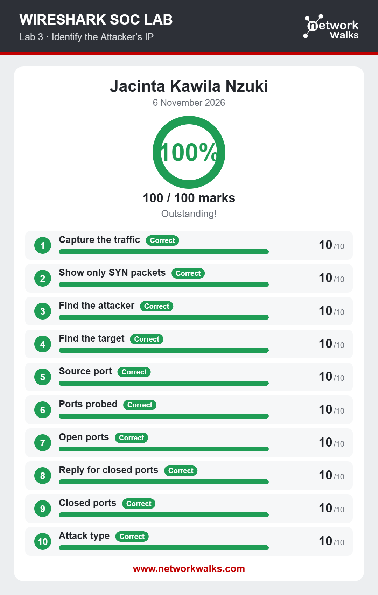
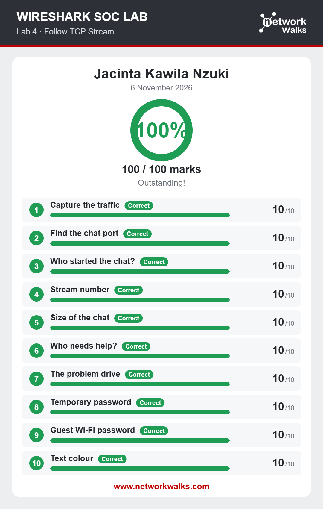
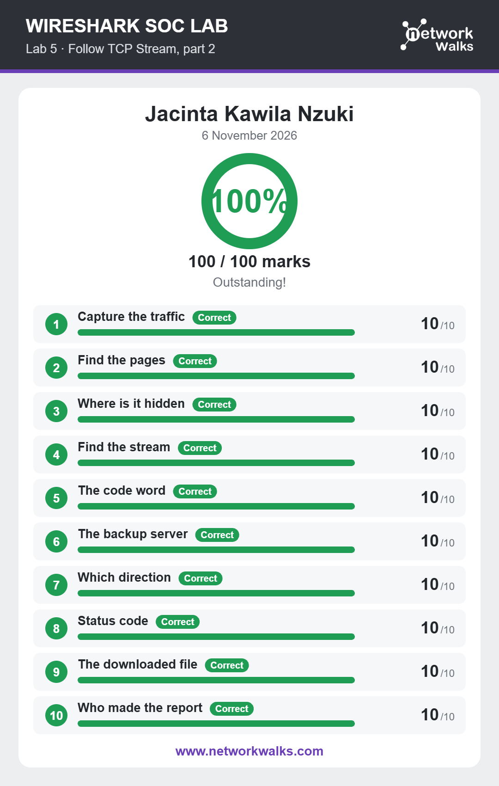
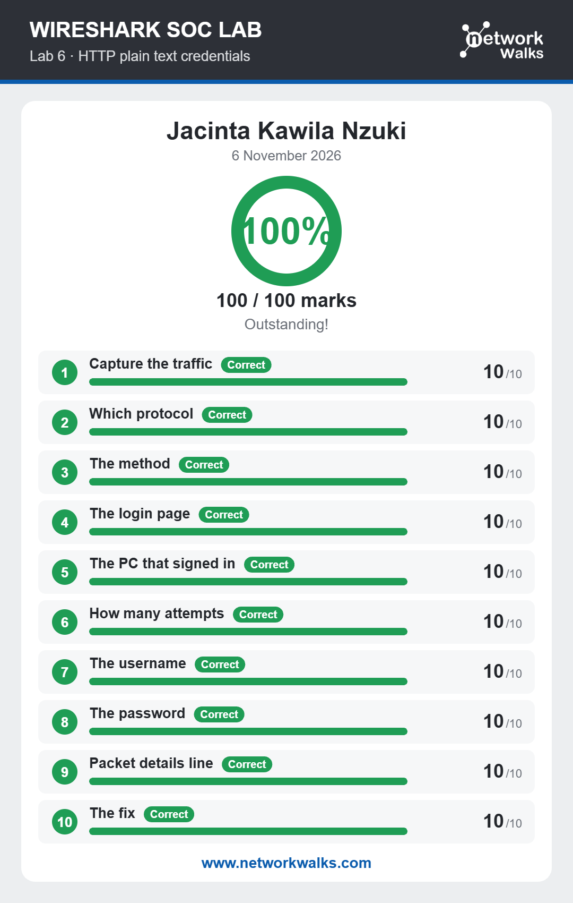
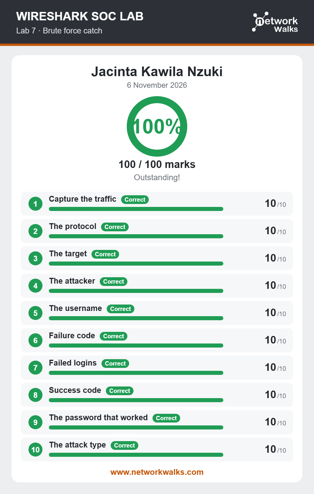
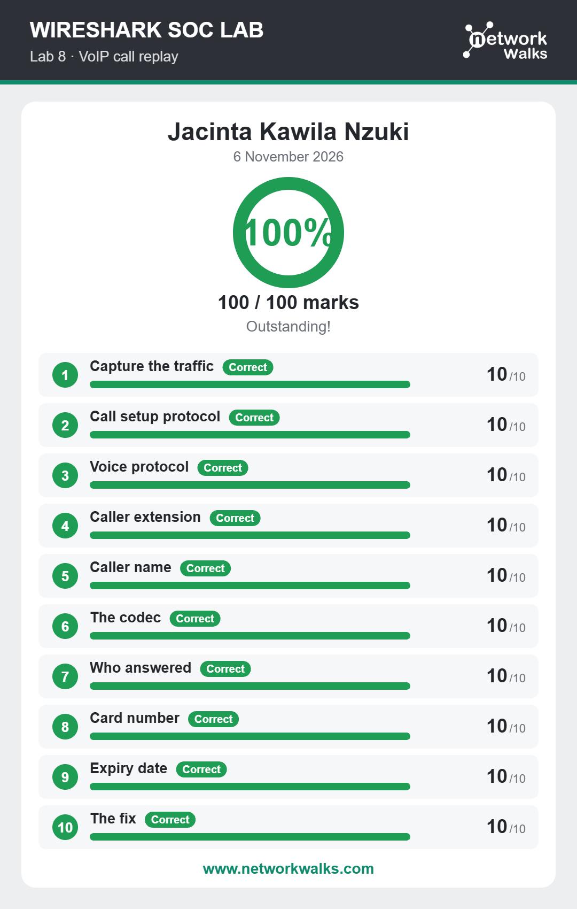

# Networkwalks SOC Project Module – Wireshark Labs (Extra)

**Author:** Jacinta Kawila

These are additional Wireshark SOC labs from my Networkwalks internship. Each lab includes a packet capture and a set of questions that require analysing network traffic in Wireshark. The corresponding result card for each lab is provided below.

## Results

| Lab | Topic | Date | Score |
|---|---|---|---|
| 3 | Identify the Attacker's IP | 11 Nov 2026 | 100/100 |
| 4 | Follow TCP Stream | 11 Nov 2026 | 90/100 |
| 5 | Follow TCP Stream, part 2 | 11 Nov 2026 | 100/100 |
| 6 | HTTP plain text credentials | 11 Nov 2026 | 100/100 |
| 7 | Brute force catch | 11 Nov 2026 | 100/100 |
| 8 | VoIP call replay | 11 Nov 2026 | 100/100 |

## Lab 3 – Identify the Attacker's IP

## Lab 4 – Follow TCP Stream

## Lab 5 – Follow TCP Stream, part 2

## Lab 6 – HTTP plain text credentials

## Lab 7 – Brute force catch

## Lab 8 – VoIP call replay

## Skills practised

- Capturing and applying filters to network traffic in Wireshark
- Analysing application data by following TCP streams
- Identifying port scanning and brute-force attacks in packet captures
- Detecting credentials transmitted in plaintext over HTTP
- Reconstructing VoIP calls by analysing SIP signalling and RTP audio traffic
